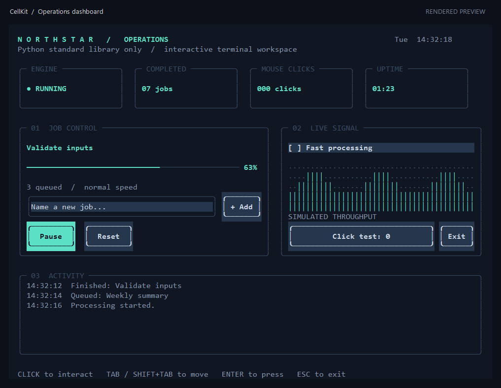
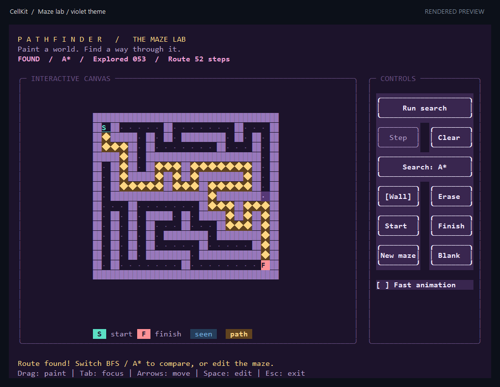
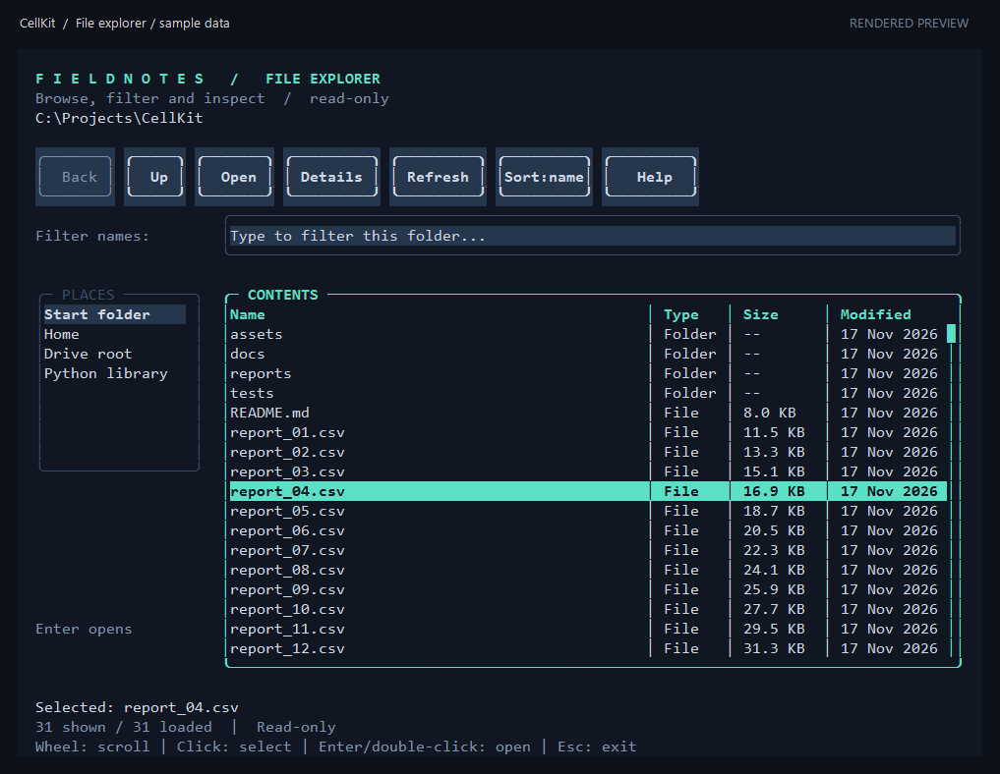
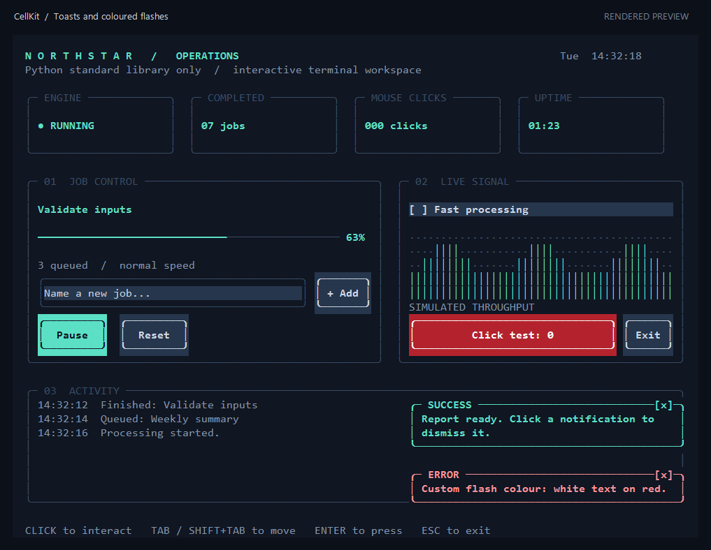

# CellKit

**Small terminal interfaces, plain Python.**

A compact Windows terminal UI library with real mouse input, clickable buttons,
editable fields, scrolling tables, dialogs, colours and timed effects. **Only
Python's standard library** is used: no pip installs or third-party packages.

CellKit began as a small, AI-agent-assisted engineering project to build a TUI
without depending on third-party UI frameworks or package maintainers. The aim is
to keep the code understandable, easy to inspect, and simple to copy into projects
where external dependencies are restricted. It relies on Python and Windows'
built-in facilities, with the source kept in your own project so you can maintain
and extend it yourself.



*Images are rendered from the demos' actual character grids with sample data.
They are labelled previews, not captures of a live terminal window. See the
[full gallery](docs/SCREENSHOTS.md).*

## Documentation

- **[Installation: which folder to copy](docs/INSTALL.md)**
- **[User guide: build an interface step by step](docs/USER_GUIDE.md)**
- **[API reference: methods, defaults and callbacks](docs/API_REFERENCE.md)**
- **[Screenshots and recording instructions](docs/SCREENSHOTS.md)**

Requires **Windows and Python 3.10+** in an interactive terminal. Intended hosts
include Windows Terminal, the Windows console and Windows VS Code integrated
terminals. Check mouse forwarding in your actual work terminal. ISE, Output panes,
redirected stdin/stdout, WSL Python, Linux and macOS are not supported.

## Run a demo

From the repository root:

```powershell
python -m demos.background
```

The hands-free showcase loops through three 20-second scenes. It types into fields,
processes jobs, solves a maze, scrolls sample files, opens dialogs, shows toasts,
and flashes controls. No interaction is needed. **Esc** exits; `--once` stops after
one 60-second loop. Its filenames are synthetic, making it suitable for recording.

Use at least **80 columns × 31 rows**; **110 × 36** is a good recording size.

| Demo | Command from the repository root |
| --- | --- |
| Small starting example | `python -m demos.hello` |
| Operations dashboard | `python -m demos.dashboard` |
| Maze, purple/pink | `python -m demos.maze --theme violet` |
| Maze, warm amber | `python -m demos.maze --theme amber` |
| Maze, navy/teal | `python -m demos.maze --theme ocean` |
| Read-only file browser | `python -m demos.files` |
| Browser in a chosen folder | `python -m demos.files "C:\Projects"` |
| Recording, one loop | `python -m demos.background --once` |
| Small form tutorial | `python -m examples.first_app` |
| Worker thread and cancellation | `python -m examples.background_job` |

Direct execution also works from inside the demo folder:

```powershell
cd demos
python background.py
python maze.py --theme violet
```

## Use just the library

Copy the entire **`cellkit` folder** beside your application script:

```text
my_project/
    main.py
    cellkit/       # All eight .py files; nothing else is required
```

You do not need demos, tests, docs, tools or cache folders. Import with
`from cellkit import App, Button`. The old package name was `tinyui`; existing
imports should be updated and running Python processes restarted.

```python
from cellkit import App, Button, Label

app = App()
status = app.add(Label(2, 2, "Ready", width=35))

def clicked():
    status.text = "Hello from CellKit!"
    app.notify("Button pressed", kind="success")

app.add(Button(2, 4, "Say hello", clicked))
app.add(Button(20, 4, "Exit", app.stop))

if __name__ == "__main__":
    app.run()
```

Run `python main.py` in a terminal. The default minimum is 41 physical columns and
12 rows; the engine reserves one terminal column to avoid wrapping.

## Features

- Buttons, labels, panels, checkboxes, single-line text fields and progress bars.
- Scrollable tables/lists with row selection, double-click, wheel and scrollbar.
- Modal dialogs with focus restoration and one to three result buttons.
- Stacking info, success, warning and error toast notifications.
- Timed flashing with your chosen foreground/background colours.
- Keyboard focus, resize/update callbacks, custom widgets and changed-row rendering.
- Working examples for cooperative background tasks and cancellation.

```python
# Flash white text on a red background:
button.flash(duration=2, style="1;38;2;255;255;255;48;2;180;35;45")
```







## Size and limits

The core is **903 lines across eight Python files**, including comments and blank
lines, excluding demos, examples, tests, docs and tooling. It stays small through
manual layout and a focused feature set.

Widgets use absolute character coordinates; panels do not own their children.
There is no automatic layout, page stack, menu/dropdown system, full Unicode width
engine, clipboard integration, multiline editor or screen-reader widget semantics.
Dialogs contain messages and buttons, not embedded forms.

The engine uses Windows' built-in `kernel32` through Python's `ctypes` for input and
terminal sequences for output. It restores the shell display and console modes on
normal exit and Python exceptions. Abrupt termination cannot run cleanup.

## Repository layout

```text
cellkit/       Library to copy into your project
demos/         Interactive demos and the hands-free showcase
examples/      Small teaching examples
docs/          Installation, guide, reference and PNG previews
tests/         unittest suite and isolated Windows console probe
tools/         Optional documentation preview generation
```

## Tests

```powershell
python -m unittest discover -s tests -v
```

Tests include native mouse/key/wheel records in a separate hidden Windows console,
modal focus handling, rendering, cancellation and cleanup. They do not send input
to your open terminal. Physical mouse forwarding still needs a check in your host.
