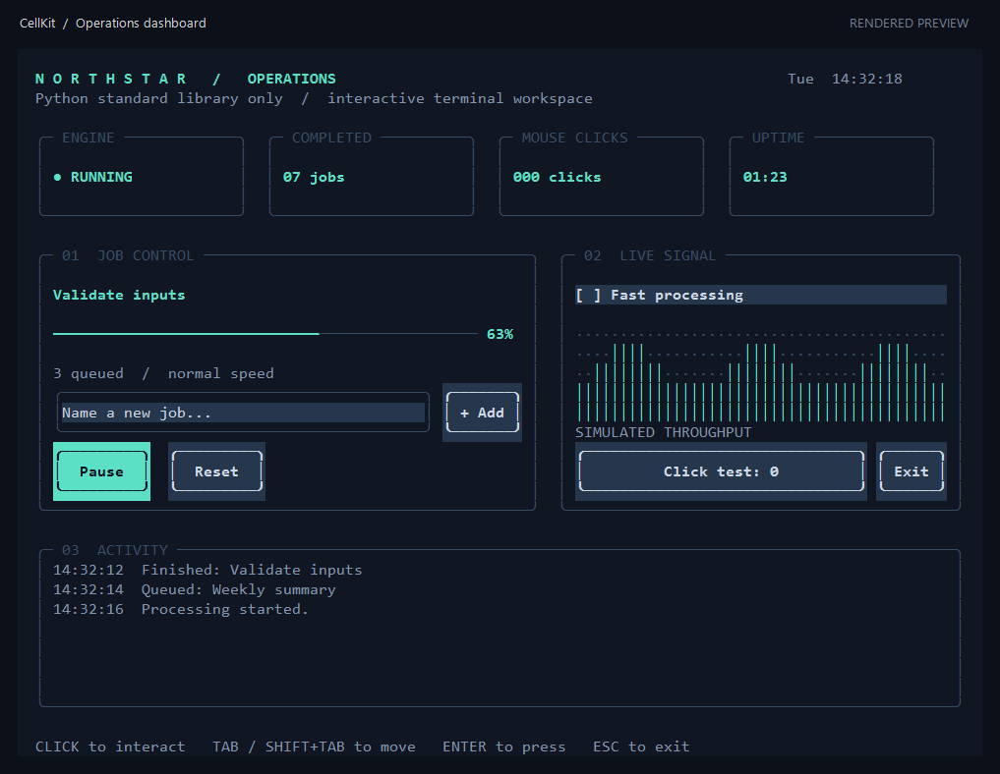
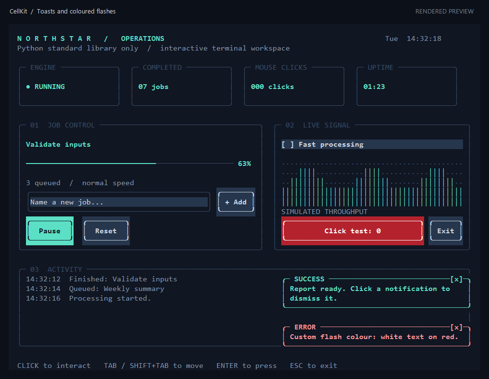
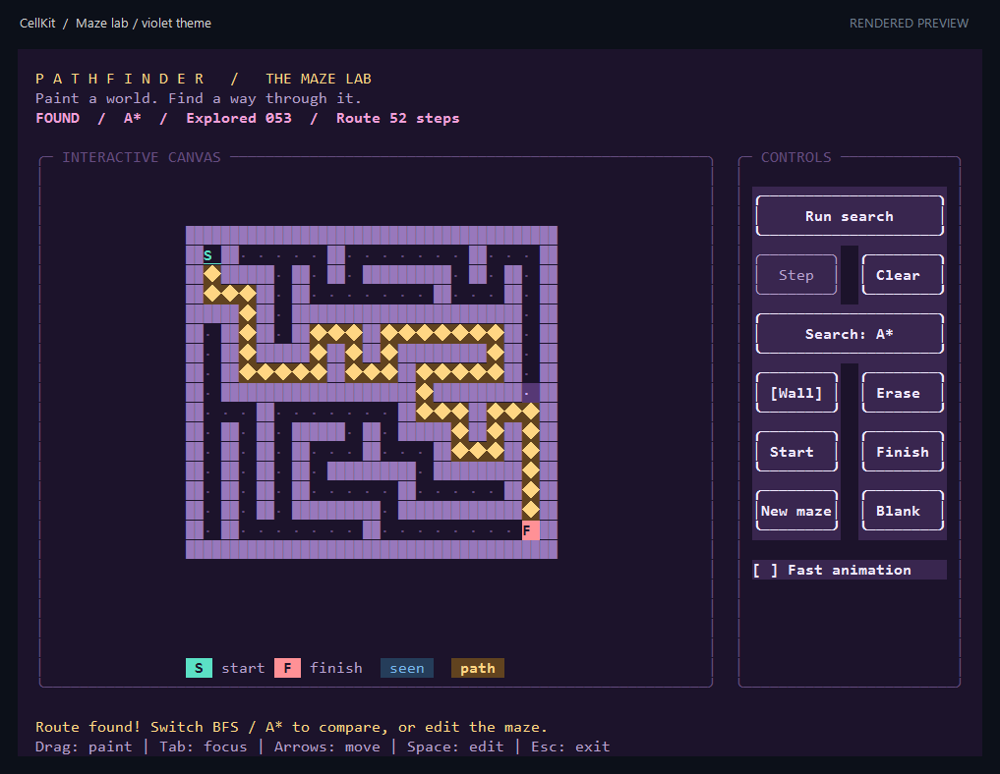
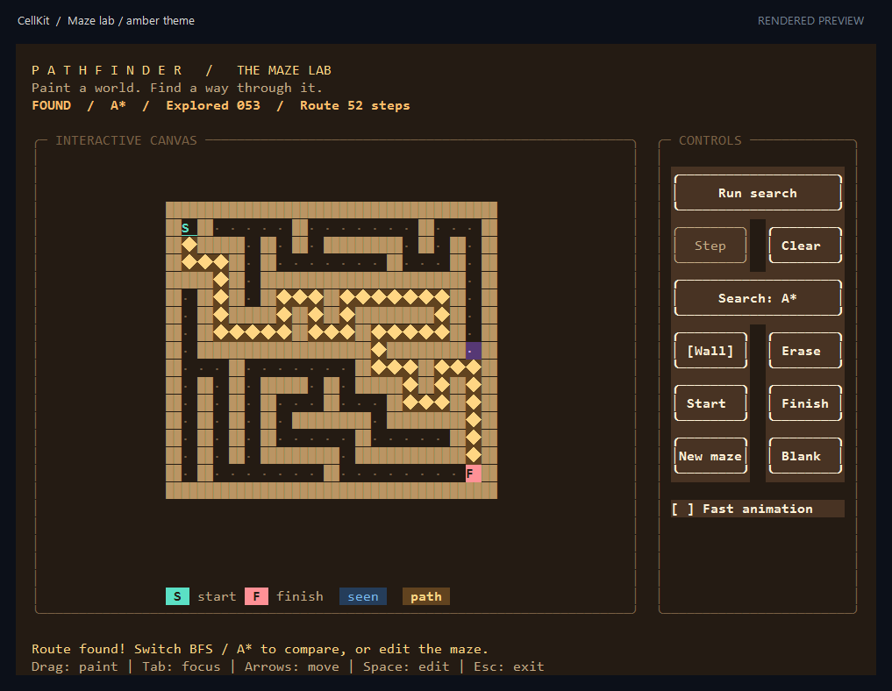
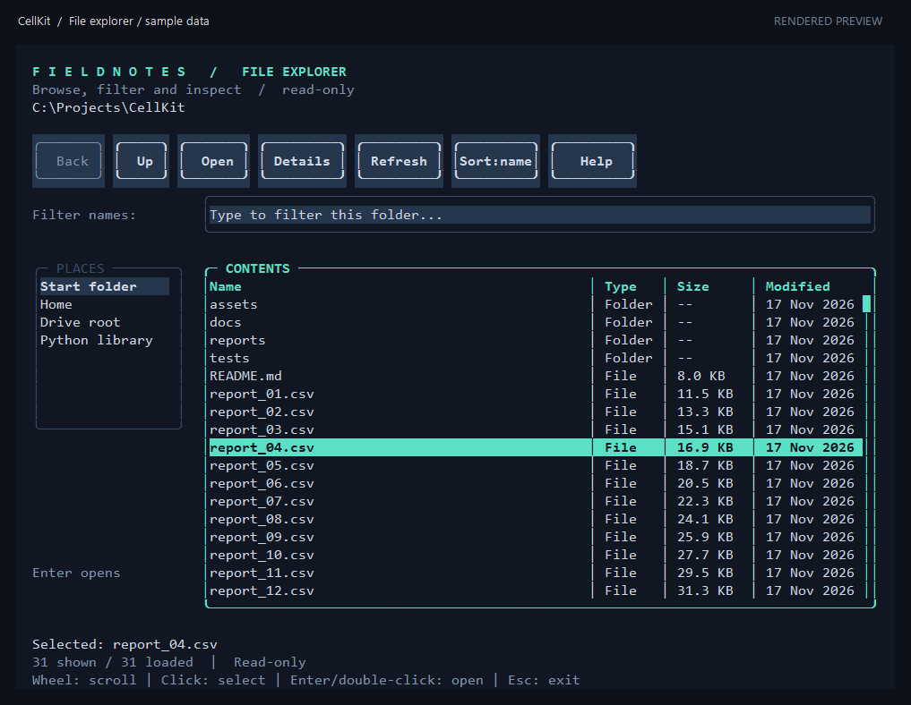
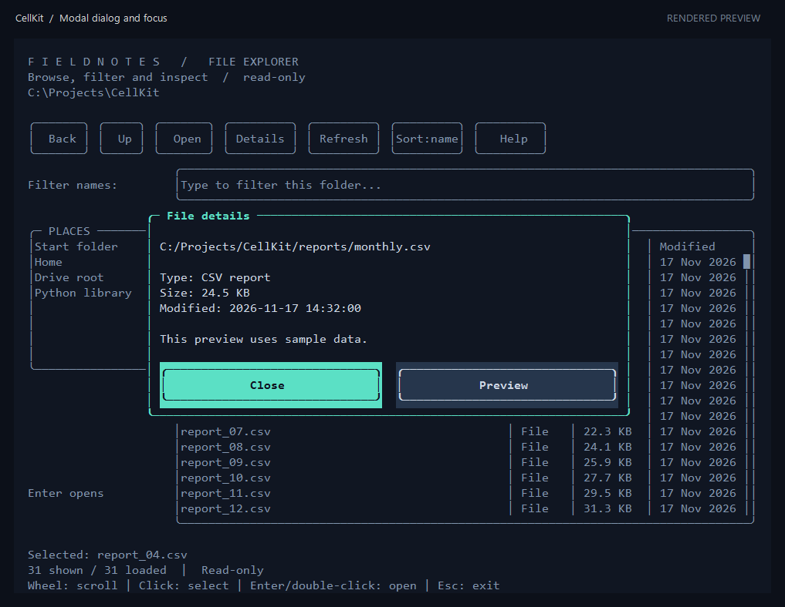

# Demo gallery

These images are rendered from the demos' **actual `Canvas` character grids**,
including their text, layout, colours and widget states. They use sample data and
are labelled **RENDERED PREVIEW**. They are not captures of a live PowerShell
window; exact font rendering depends on your terminal.

## Operations dashboard

Run `python -m demos.dashboard`.



## Toasts and a red flash

The dashboard's **Click test** cycles notification styles and flashes its button.
The automatic showcase also demonstrates a white-on-red flash explicitly.



## Maze: violet

Run `python -m demos.maze --theme violet`.



## Maze: amber

Run `python -m demos.maze --theme amber`.



## File explorer

Run `python -m demos.files`. The normal demo browses real folders read-only;
the image below uses a synthetic listing.



## Modal dialog



## Record the automatic showcase

```powershell
python -m demos.background
```

Use around 110 columns and 36 rows. Each scene lasts 20 seconds; the full sequence
loops every 60 seconds. `--once` exits after one loop. Esc or Ctrl+C exits at any
time. Other interaction is ignored during playback. The program never moves your
system mouse or controls another application. From inside `demos`, the equivalent
command is `python background.py`.

## Regenerate these images

Run from the repository root on Windows:

```powershell
python -m tools.export_previews
powershell -NoProfile -File tools/render_previews.ps1
```

The exporter uses the actual demo models and CellKit renderer. The image writer
uses Windows' built-in .NET `System.Drawing` and a monospace font; no pip dependencies.
Intermediate JSON goes into ignored `.test-results/previews`. These tools are only
for documentation and are not required by the library.
